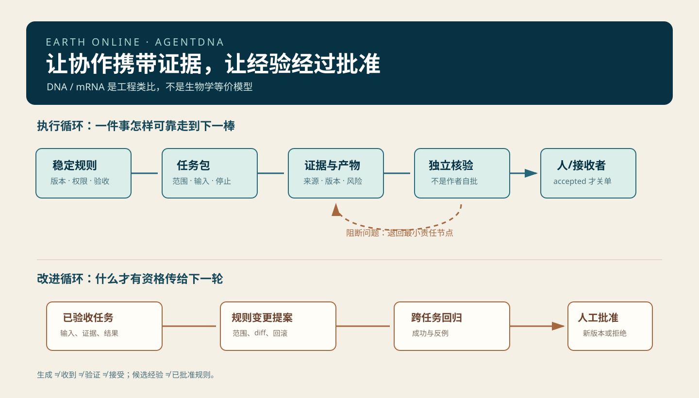

# Earth Online · AgentDNA

> 让 Bot 继承经过验证的做事规则，让每一次协作携带证据，让失败能够定位、隔离与回退。


**一人定方向，多 BOT 成阵。** AgentDNA 把稳定规则、任务上下文、证据交接、独立校对和人工验收组织成一套可复用的开源 Skill 协议。

[深度研究报告](docs/research-report.md) · [完整部署说明](docs/DEPLOYMENT.md) · [推广文案](docs/promotion-post.md) · [WorkBuddy 指南](docs/WORKBUDDY.md)

一个人主导的多 Bot 协作协议与 WorkBuddy Skill 包。它把 DNA→mRNA→功能产物视为工程隐喻：稳定规则经过选择后形成有有效期的任务包；执行产生可检查产物；独立复核与人工验收决定任务是否关闭；只有证据充分的规则变更才进入下一个版本。



## 这是什么

AgentDNA 是一套原创的协作约定，不是一个自动调度器，也不承诺“Bot 越多越准确”。它帮助一位人类负责人让复杂任务经过研究、构建、独立核对和接收时仍保留：目标、来源、版本、责任、权限和验收状态。

最小配置只需要三种职责：

1. 协调兼构建：冻结任务契约并整合产物。
2. 证据研究：提供可回到原始来源的事实包。
3. 独立复核：不参与成稿，检查当前版本是否满足契约。

人始终决定目标、外部写操作、最后接收，以及哪些经验进入长期规则。

## 五种 Skill

| Skill | 输出 | 用途 |
|---|---|---|
| `gene-spec` | TaskPacket | 把目标、权限、输入、预算、停止条件固定下来 |
| `evidence-transcribe` | EvidencePacket | 将来源、日期、主张状态和不适用边界结构化 |
| `proofread-gate` | VerificationReport | 将“文件生成”“收到”“验证”“接受”分开记录 |
| `heritage-proposal` | ChangeProposal | 只提出经验升级候选，由人批准后才改规则 |
| `agentdna-research` | ResearchBrief → EvidenceLedger → Synthesis → Verification | 一支自包含的深度调研主流程，适合直接部署到 WorkBuddy |

每支 Skill 都是自包含目录；可从 `.codebuddy/skills/` 项目级加载，也可按 WorkBuddy 平台当日文档打包上传。安装、加载和真实多代理调度需在你的客户端验证，本仓库不伪造运行记录。

## 五分钟演练

1. 复制本仓库到一个新的低风险工作目录。
2. 读取 `examples/fde-handoff/`。它是虚构 FDE 行业简报演练，不代表真实客户、研究或实测。
3. 先由 `gene-spec` 产出 TaskPacket。
4. 由 `evidence-transcribe` 补齐三条有 URL 和状态的证据卡。
5. 构建者只消费已批准的证据包，交付带版本的草稿。
6. 让未参与构建的角色运行 `proofread-gate`。只有 `accepted` 才关单。
7. 有跨任务复用价值的经验才用 `heritage-proposal` 提案；不要自动更新技能或长期记忆。

## 先做基线，再谈规模

本项目建议把同一任务交给四种组别：单代理、带契约的单代理、三职责协作、可选异构协作。记录一次验收通过率、事实错误密度、证据覆盖率、交接损失、端到端时间、模型/工具成本和人工分钟。具体设计见 [评估计划](docs/evaluation-plan.md)。

多智能体研究没有证明“越多越好”。可拆分的研究任务可能从并行中受益；强顺序任务与高通信任务可能退化。相关文献、案例和边界见 [研究报告](docs/research-report.md)。

## 使用边界

- DNA、mRNA、校对和“遗传”均为工程隐喻，不主张 AI 拥有生物遗传或生命特征。
- 事实必须回到来源；模型自述、多人一致和真实验收是不同层级。
- 同一模型的多角色会共享错误。必要时增加独立证据、不同检索路径或异构模型。
- 不把客户资料、私人书稿、密钥、原始 trace 放进这个公开仓库。
- 发布、发送、付款、删除和生产变更应保持人工审批。

## 仓库结构

```text
.
├── .codebuddy/skills/      # 五支 WorkBuddy 项目级 Skill
├── assets/                 # 原创 SVG 图示
├── docs/                   # 协议、评估、研究和 WorkBuddy 指引
├── examples/               # 明确标注为虚构的演练
└── templates/              # 可机器读取的交接数据模板
```

## 研究与来源

报告优先引用官方平台资料、论文、公开源码和 Karpathy 一手材料。公开现场测试只作为案例，预印本、摘要和厂商自报均保留限制。关键来源包括：

- [Grok Bot 官方工作机制](https://docs.x.ai/grok-bot/how-grok-bot-works)
- [WorkBuddy 项目配置](https://www.codebuddy.cn/docs/workbuddy/From-Beginner-to-Expert-Guide/Function-Description/Project)
- [Karpathy × Dwarkesh 逐字稿](https://www.dwarkesh.com/p/andrej-karpathy)
- [Anthropic 多智能体研究系统](https://www.anthropic.com/research/multi-agent-research-system)
- [MAST：多智能体系统为何失败](https://arxiv.org/html/2503.13657v3)
- [DNA 复制保真综述](https://pmc.ncbi.nlm.nih.gov/articles/PMC6153641/)

## 发布状态

`v0.1.0`：开源首发版。Skill 结构、模板和 JSON 已完成本地校验；WorkBuddy 客户端导入、Grok Bot 真实多 Bot 调度与业务提效仍需按部署说明留存实测证据。

## 许可证与致谢

本仓库中的原创协议、模板、示例和图示使用 MIT License。方法组织受到 [Solo to Team](https://github.com/dabingfy-dot/solo-to-team-skills) 的“派—收—核—判”和证据优先思想启发；未复制其源文件、图稿或 PDF。完整说明见 [NOTICE.md](NOTICE.md)。
