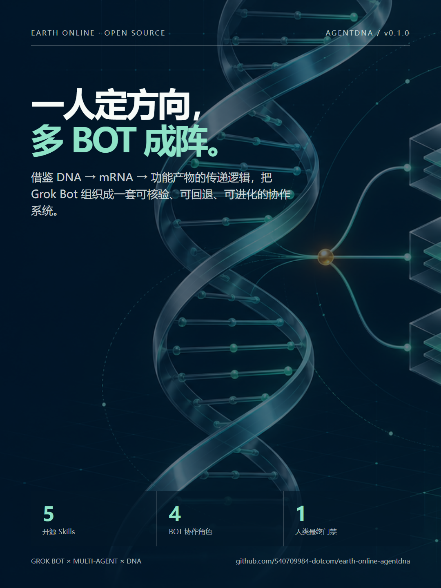
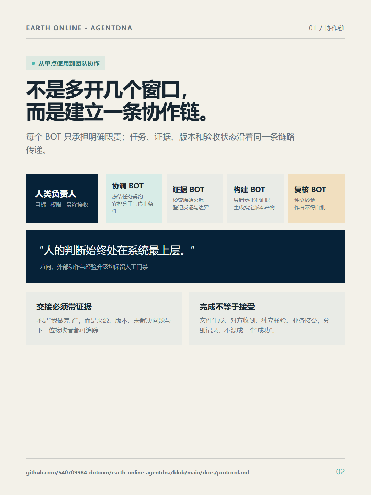
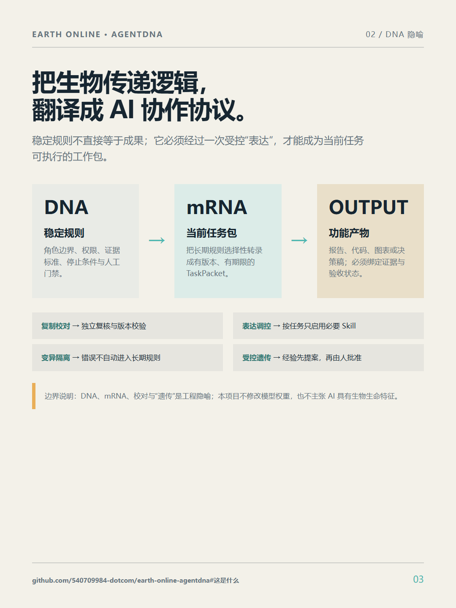
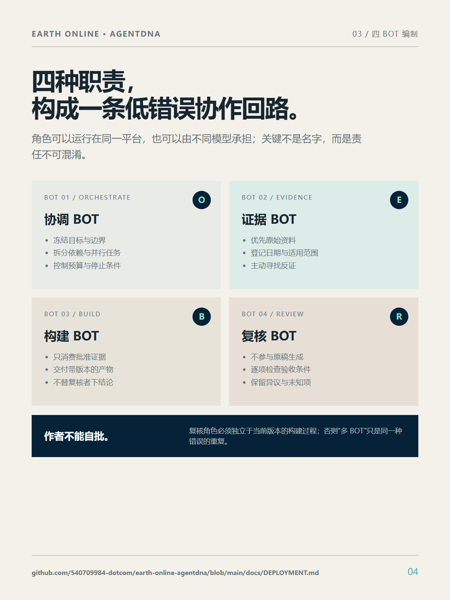
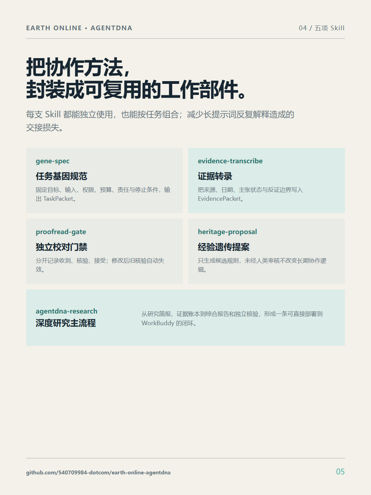
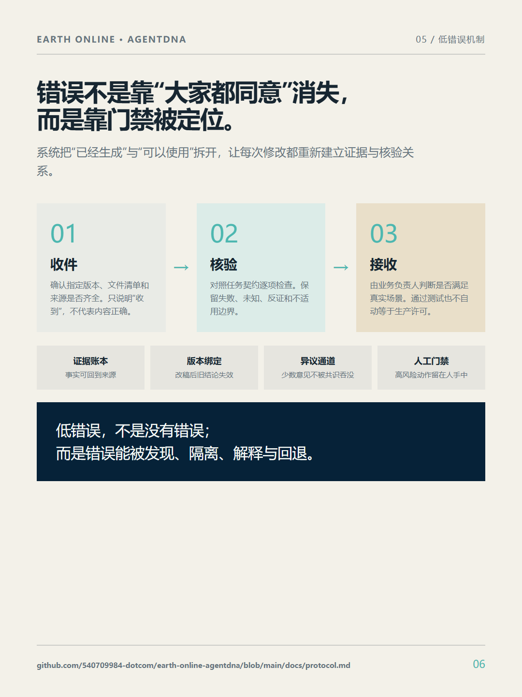
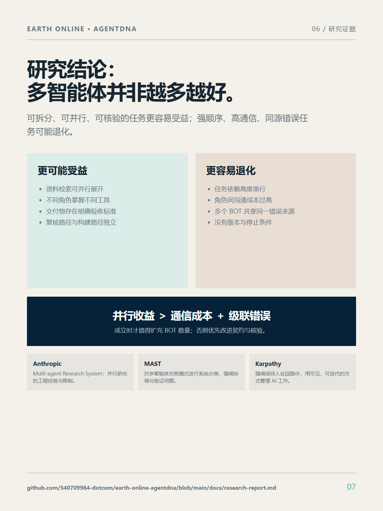
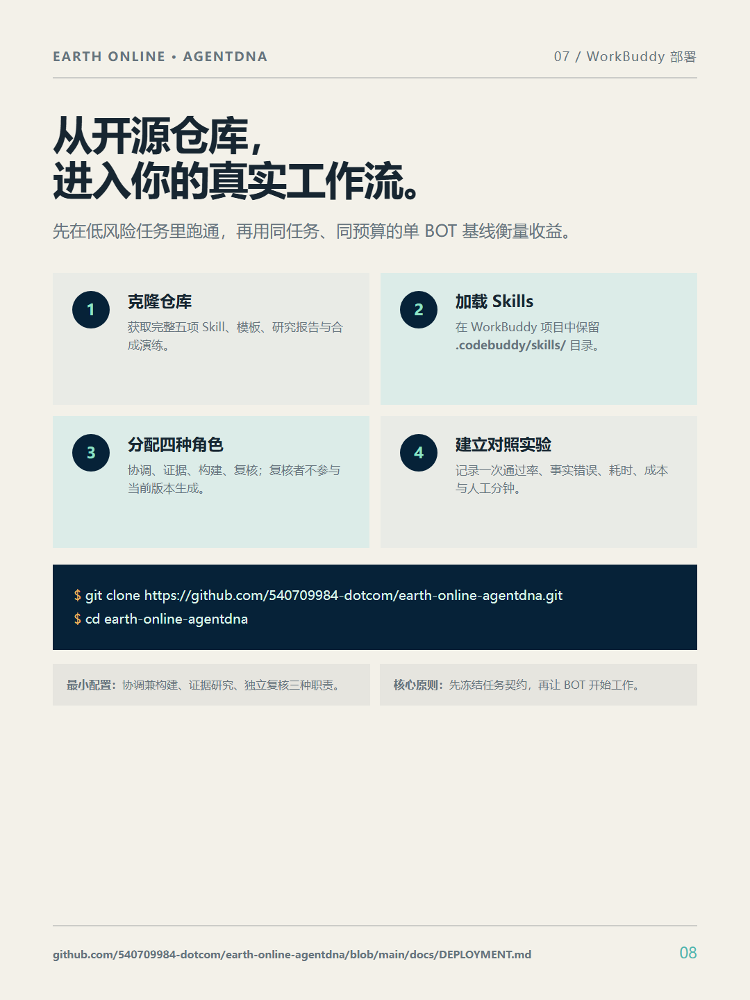
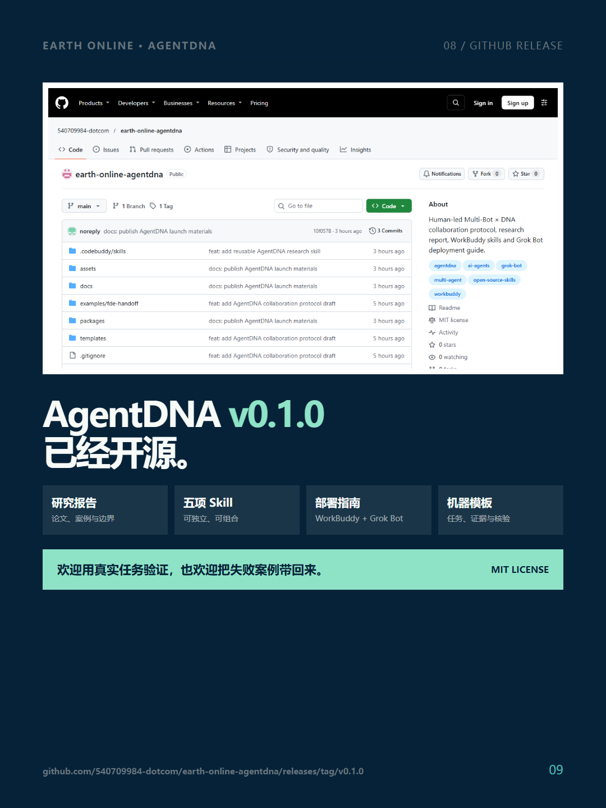

# AgentDNA 朋友圈九图发布包

## 可直接复制的朋友圈文案

**一人定方向，多 BOT 成阵。**

我把自己使用 Grok Bot 的协作方法，整理成了一个开源项目：**Earth Online · AgentDNA**。

它借鉴 DNA → mRNA → 功能产物的传递逻辑：稳定规则像 DNA，当前任务包像 mRNA，多个 BOT 分别负责协调、证据、构建与独立复核；最终产物必须携带来源、版本和验收状态交回。人的判断始终在系统最上层，决定目标、外部动作，以及哪些经验可以进入下一版规则。

这不是“多开几个 AI 窗口”，也不承诺 BOT 越多越准确。它更关心三件事：任务交接后目标不丢、结论能够回到证据、错误能够被发现和回退。

首个开源版本包含 5 项 Skill、深度研究报告、WorkBuddy 部署说明、Grok Bot 四角色编制，以及机器可读的任务、证据与核验模板。

项目地址：  
https://github.com/540709984-dotcom/earth-online-agentdna

正式版本：  
https://github.com/540709984-dotcom/earth-online-agentdna/releases/tag/v0.1.0

欢迎用真实任务验证，也欢迎把失败案例带回来。只有经得住反证的协作规则，才值得被“遗传”。

`#GrokBot` `#MultiAgent` `#AgentDNA` `#AI协作` `#开源Skill` `#WorkBuddy`

## 九张配图与对应链接

### 1. 封面：一人定方向，多 BOT 成阵

[GitHub 仓库首页](https://github.com/540709984-dotcom/earth-online-agentdna)

### 2. 从单点使用到团队协作

[AgentDNA 协议](https://github.com/540709984-dotcom/earth-online-agentdna/blob/main/docs/protocol.md)

### 3. DNA → mRNA → 功能产物

[项目方法说明](https://github.com/540709984-dotcom/earth-online-agentdna#这是什么)

### 4. 四种 BOT 职责

[Grok Bot 与 WorkBuddy 部署说明](https://github.com/540709984-dotcom/earth-online-agentdna/blob/main/docs/DEPLOYMENT.md)

### 5. 五项开源 Skill

[Skill 目录](https://github.com/540709984-dotcom/earth-online-agentdna/tree/main/.codebuddy/skills)

### 6. 低错误协作门禁

[接收、核验与人工门禁](https://github.com/540709984-dotcom/earth-online-agentdna/blob/main/docs/protocol.md)

### 7. 多智能体研究证据

[深度研究报告](https://github.com/540709984-dotcom/earth-online-agentdna/blob/main/docs/research-report.md)

### 8. WorkBuddy 部署路径

[完整部署说明](https://github.com/540709984-dotcom/earth-online-agentdna/blob/main/docs/DEPLOYMENT.md)

### 9. GitHub 开源证明

[AgentDNA v0.1.0 Release](https://github.com/540709984-dotcom/earth-online-agentdna/releases/tag/v0.1.0)

## 发布顺序

朋友圈上传时按 `01` 到 `09` 的文件名顺序选择。微信九宫格会裁切缩略图，点击后显示完整的 1080 × 1440 纵版页面。
