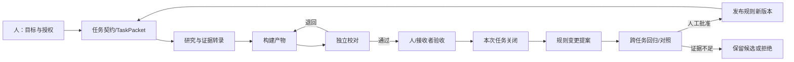

# 地球 Online · AgentDNA

## 让多个 AI Bot 像“基因表达系统”一样协作：理论、证据、边界与 WorkBuddy 部署方案

**研究日期：** 2026-11-08  
**版本：** v0.9 研究交付稿  
**结论置信度：** 框架可实施性中高；跨任务提效幅度与错误率改善尚待本地对照实验  
**材料范围：** 用户初步报告、10张“大冰”参考图、Obsidian相关书稿、Grok Bot与WorkBuddy官方资料、Karpathy一手材料、多智能体研究论文及公开案例  

> 这里的 DNA、mRNA、校对、表达与遗传是受生物学启发的工程隐喻。AgentDNA 不是生物学模型，也不宣称 AI 已拥有生命式遗传。它要解决的实际问题很朴素：一条任务经过多个 Bot 后，目标、证据、版本和责任仍然能对得上。

---

## 执行摘要

Grok Bot 好用的底层原因，首先是产品形态，而不是某种神秘的“群体智能”：Bot 有持续运行的云电脑、各自的职责记忆、可见的交接和并行工作界面；同一组 Bot 又能共享文件与登录环境。用户因此少做了复制、粘贴、催办和上下文搬运。官方文档也同时给出边界：这些 Bot 共享云电脑，不构成权限隔离；群聊中的每次回复与互相交接都消耗额度；平台管理模型选择，用户不能把多个 Bot 名字直接等同为多个独立模型。[Grok Bot工作机制](https://docs.x.ai/grok-bot/how-grok-bot-works) · [协作说明](https://docs.x.ai/grok-bot/chat-and-collaboration) · [设置说明](https://docs.x.ai/grok-bot/settings-and-notifications)

研究证据不支持“Bot 越多，错误越低”。多智能体系统在可并行、可验证、可分解的任务上可能明显受益；在顺序依赖强、通信开销大或评价标准模糊的任务上，协作可能退化。相同模型形成的多个角色还可能共享同一种错误。已有研究中的亮眼数字高度依赖任务：保险论文在500个整理案例上把作者定义的幻觉率从11.3%降到3.8%，不等于开放办公场景能稳定低于5%；百万步零错实验是在策略已知的汉诺塔环境中完成，也不能外推为长篇研究或真实运营零错。

本报告提出的核心创新是 **“三层双循环”**：

1. 人的目标与判断层：定义为什么做、接受什么、哪些动作必须由人决定。
2. 团队契约与证据层：保存稳定规则、临时任务包、来源、版本、交接和验收状态。
3. Bot执行与工具层：研究、生成、调用工具、交付产物。

执行循环负责完成当前任务；改进循环负责把失败或有效方法变成“规则变更提案”。运行结果不能自动进入长期记忆，只有经过证据回读、跨任务验证和人工批准的规则，才成为下一版本的“协作基因”。

最小有效编制不是五六个常驻 Bot，而是三个职责：协调兼构建、证据研究、独立复核。任务可以独立并行时再拆角色；高风险事实可增加异源核验，不能用多数投票代替原始证据。面向 WorkBuddy，本轮已设计为四支可单独导入的 Skill：任务契约、证据转录、独立校对、经验提案。它们提供协议和模板，不伪装成已经运行的调度器。

---

## 1. 研究问题与材料边界

本轮回答五个问题：

1. Grok Bot 的多 Bot 体验为什么会比单轮聊天顺手？
2. 多智能体是否已有“高效率、极低错误”的可靠实证？适用条件是什么？
3. DNA→RNA→蛋白质及校对机制能为协作系统提供什么结构启发？
4. Karpathy关于上下文、共享文化、评估和部分自治的公开思路如何进入设计？
5. 怎样把这套理论变成可导入 WorkBuddy、可公开到 GitHub、可做对照实验的资产？

### 1.1 已读材料

- 用户的《初步研究报告.docx》。文档没有外部超链接，因此其中数字必须重新找源。
- 用户提供的10张“大冰”项目参考图；第3与第10张内容重复。图中核心表达是“专业有归属、协作有现场”“派—收—核—判”和接收/核证分离。
- 对应公开仓库 [dabingfy-dot/solo-to-team-skills](https://github.com/dabingfy-dot/solo-to-team-skills)。借鉴其信息组织和诚实验收口径，没有复制其图稿、PDF、技能源文或组织图。
- Obsidian中与“人性基因锁”高度相关的约9.2万字《虚拟现实通关指南原稿》、世界观、AI三步迭代与团队架构等材料。没有找到文件名精确等于《地球Online之人性基因锁》的最终定稿；相关文案能证明该原稿属于同一书籍体系。三篇课程文件只有转换失败占位，未读到正文。
- Grok Bot、WorkBuddy、Karpathy一手资料和论文/官方研究报告。

### 1.2 未完成输入

用户提到的抖音分享链接没有随附件到达，本轮不能声称已观看。报告把“为什么好用”的解释建立在 Grok Bot 官方文档、公开同题测试及用户初步材料上。收到链接后可补做视频逐句核证，不影响当前理论和部署包成立。

---

## 2. Grok Bot 为何好用：把上下文搬运变成产品能力

### 2.1 四个真实机制

**持续执行。** Bot运行在云电脑上，客户端或笔记本关闭后，后台任务和例行任务仍可继续。这使“研究30分钟后回来取件”成为产品流程，而不是维持一个网页会话。[官方FAQ](https://docs.x.ai/grok-bot/faq)

**职责化记忆。** 官方说明每个Bot有自己的规则与工作日志，少量用户事实跨Bot共享。长期任务因此可以累积角色上下文，但价格、预算等会变的数字仍应重新查询。[工作机制](https://docs.x.ai/grok-bot/how-grok-bot-works)

**可见交接。** 群聊支持2—6个Bot，Bot可以互相异步发消息。官方建议为每个阶段指定一名负责人。用户能看到谁在研究、谁在接棒、谁退回了问题。[群聊与交接](https://docs.x.ai/grok-bot/chat-and-collaboration)

**同一执行环境。** 多个Bot共用文件、命令行环境和浏览器登录态，减少人为搬运。代价是它们并未安全隔离；一个Bot能访问的计算机内容通常对其他Bot也可用。发布、删除、发送和不可逆操作必须设置审批。[审批与隐私](https://docs.x.ai/grok-bot/approvals-security-and-privacy)

这四项共同降低的是“协作摩擦”。它们没有自动解决事实真假、验收口径和同源错误。

### 2.2 一个有价值、但不能过度解读的同题测试

雷峰网让 Grok Bot、WorkBuddy 与 Qoder CN 完成同一份“大模型路由研究综述”。Grok Bot用12分49秒交出覆盖最广的研究包，WorkBuddy用21分43秒交出更接近编辑底稿的正文，Qoder CN用14分42秒展示了一次有效交叉纠错。Grok的独立审稿删除了两个未核实百分比并修正论文编号；三家最终交付也各自仍有文件引用、数字口径或方法分类问题。[雷峰网原文](https://www.leiphone.com/category/yanxishe/6QM0ls2hB4Dhqgbh.html)

这是一次公开现场测试，不是随机对照实验：只有一项任务，没有重复样本，没有统一后端模型和成本控制。它能证明多角色协作已经能完成具体工序，也同时说明“生成了8个文件”和“形成可靠结论”是两种状态。

初步报告里的“MIT教授用3个Grok Bot一小时完成读图、仿真、3D打印”没有找到可核对的本人实验记录，本报告不把它列为实证。

### 2.3 成本和权限不能被流程美感遮住

官方明确：Bot群聊中的每次回复、Bot间消息和Routine测试都会消耗用量；宽泛的触发器可能在一天内耗掉一周额度。Webhook返回200只表示任务已启动，不表示已经完成。[Skills与Routines](https://docs.x.ai/grok-bot/skills-routines-and-automations)

因此协作系统的成本指标应是：

`单位被验收成果成本 = 总模型/工具/人工成本 ÷ 被接收且可用的成果数`

只看“同时跑了几个Bot”或“几分钟交稿”，会把返工、审查、失败运行与人的接管时间藏掉。

---

## 3. DNA 类比的科学底座与工程边界

### 3.1 生物学事实

蛋白质编码相关的遗传信息通常由DNA转录形成RNA；mRNA把信息带到细胞质，由核糖体读取并翻译为多肽。RNA不是一种单一“信使”，还包括转运、结构、催化和调控等多种类型；RNA剪接还会改变可被翻译的信息组合。[MedlinePlus](https://medlineplus.gov/genetics/understanding/howgeneswork/makingprotein/) · [NHGRI RNA Fact Sheet](https://www.genome.gov/about-genomics/educational-resources/fact-sheets/ribonucleic-acid-fact-sheet)

DNA复制的高保真来自多层机制：聚合酶选择、外切校对、复制后错配修复。酵母研究还显示，Polδ能够纠正Polε产生的一部分错误，这为“执行者之外的交叉校对”提供启发；它没有证明多个AI审核者会自动获得同样效果。[DNA复制保真综述](https://pmc.ncbi.nlm.nih.gov/articles/PMC6153641/) · [Polδ交叉校对研究](https://pmc.ncbi.nlm.nih.gov/articles/PMC7084062/)

### 3.2 不能说成什么

- mRNA不是DNA本身变成的任务执行者；它是依据模板生成的信息载体。
- mRNA不会把每次执行经验自动回写DNA。Agent工作记录也不应自动修改长期规则。
- 生物复制中的每碱基错误率不能作为AI办公错误率目标。两种错误的单位、分布和环境完全不同。
- “校验和一致”只能证明文件没有意外改变，不能证明内容真实。
- 多个同一模型扮演不同人格，不保证错误独立。

### 3.3 AgentDNA 的工程映射

| 生物启发 | 工程实体 | 验收标准 |
|---|---|---|
| DNA / 稳定信息 | 版本化团队约定、角色边界、验收契约 | 经过审核发布；保留差异与回滚点 |
| 转录 | 任务编排 | 只选择本任务需要的规则与上下文 |
| mRNA | 有版本、会过期的任务包 | 目标、输入、权限、预算、输出、停止条件齐全 |
| 翻译 | Bot与受限工具执行 | 产物和工具证据优先于模型自述 |
| 蛋白质功能 | 文档、代码、数据、决策草案 | 下一位接收者能依契约使用 |
| 调控 | 权限、预算、上下文路由 | 同一规则库按任务激活不同能力 |
| 校对与修复 | 独立审核、执行测试、来源回读 | 作者不自批；问题能定位并退回 |
| 变异 | 规则变更提案 | 不自动合并；需回归与人审 |
| 工程“遗传” | 已批准、可迁移的技能/模板版本 | 换执行者、换任务后仍能正确复用 |

---

## 4. 核心理论：三层双循环

### 4.1 三层

**人的目标与判断层**保存意图、优先级、价值判断和授权。人决定什么值得做、什么算可接受、哪些失败可以容忍。外发、发布、付款、删除、真实生产变更等动作沿用既有授权门槛。

**团队契约与证据层**是协作真正的“中间组织”。它包含稳定规则、TaskPacket、证据卡、HandoffReceipt、VerificationReport与ChangeProposal。Bot之间传递结构化文件，而不是只传“我觉得已经好了”。

**Bot执行与工具层**负责搜索、分析、生成、计算与操作工具。这里产出的是候选结果，只有经过接收与验证，才进入可用状态。

### 4.2 两条循环



执行循环是 `目标→任务包→证据→产物→独立校对→接收`。改进循环是 `结果→错误归因→变更提案→回归→人工批准→新规则版本`。两个循环分开，阻止“一次回答看起来不错”直接变成所有Bot的永久真理。

### 4.3 四种“完成”必须分开

1. `generated`：文件或回复已生成。
2. `received`：下一位负责人确认收到且版本正确。
3. `verified`：独立核对通过，证据与当前版本匹配。
4. `accepted`：人或业务接收者确认可以使用。

只有 `accepted` 才能关闭任务；只有多次accepted且证据支持的方法，才有资格进入规则变更提案。

---

## 5. 多智能体证据：什么时候增益，什么时候退化

### 5.1 可以支持的结论

**并行搜索与异质候选有机会增加覆盖面。** Anthropic公开其多智能体研究系统时报告，在内部研究评估中，多代理编排相对单代理获得90.2%的性能提升；同时系统使用的token约为普通聊天的15倍。两者的基线不同，不能写成“比单代理贵15倍”，也不能把内部研究评估外推到所有任务。[Anthropic工程说明](https://www.anthropic.com/research/multi-agent-research-system)

**独立批判在特定领域可以改善指标。** 商业保险预印本在500个专家验证、但经过整理的案例上，报告幻觉率11.3%→3.8%、准确率92%→96%，中位处理时间则从15分钟升至20分钟。样本来自约1000段合成/整理对话抽样，并非真实生产日志；这个数字只能描述该实验定义下的任务。[论文](https://arxiv.org/abs/2602.13213)

**固定评估与有限动作空间能支持很长的可靠序列。** [MAKER](https://arxiv.org/html/2511.09030v1) 在给定可验证子任务与高冗余采样的环境中完成百万步级汉诺塔执行。它证明了局部验证、重试与多数聚合在封闭任务中的力量，也说明成本会随着冗余急剧增加；不能推导开放研究“百万步零错”。

**先独立生成再比较可以减弱早期锚定。** Karpathy的 [LLM Council](https://github.com/karpathy/llm-council) 让多模型先独立回答、再匿名互评、最后由主席整合。仓库明确是探索性周末项目，没有给出办公提效对照实验。

### 5.2 必须保留的反证

多智能体失败研究把问题归纳为规范/系统设计、代理间错配和任务验证三类。常见表现包括角色定义互相冲突、消息丢失或错误继承、协调者过早终止、审稿者只检查格式以及工具错误被下游当作事实。[Why Do Multi-Agent LLM Systems Fail?](https://arxiv.org/abs/2503.13657)

大规模配置实验显示，多代理增益取决于任务结构：可并行分解的任务更可能受益；顺序依赖和高协调任务可能因通信开销与错误累积而变差。所谓“增加代理数量”不是单调提升旋钮。[Towards a Science of Scaling Agent Systems](https://arxiv.org/abs/2512.08296)

METR在2025年对熟悉代码库的开发者实验中观察到使用当时AI工具平均反而慢19%；后续工具与模型已变化，该结果不应当作2026年所有编码任务的常数。它提醒我们测量真实完成时间和返工，而不是用主观速度感替代结果。[METR研究](https://metr.org/blog/2025-07-10-early-2025-ai-experienced-os-dev-study/)

### 5.3 对初步报告数字的处理

| 初步说法 | 核验后处理 |
|---|---|
| “小模型组合可逼近671B，token降50%+” | MA-CF出版社摘要支持特定幻觉缓解任务中8B组合可匹配/超过671B；本轮未取得全文方法表，50%+ token不进入已核结论 |
| “11.3%→3.8%，92%→96%” | 保留，明确500个整理案例、作者指标、预印本、非生产日志 |
| “AI办公室拦截90%内部错误” | 撤回该表述；原表更接近对392个初始失败会话恢复351个（约89.5%），总体成功/接受481/522；不能叫“拦截错误” |
| “MAME数学推理+24%” | 出版社摘要可见up to 24.05%，具体基线和百分比口径未全文核对；列为延伸阅读，不作设计承诺 |
| “多Bot可把幻觉压到5%内” | 删除。没有跨任务、跨平台的统一幻觉率，也没有本地基线 |
| “Karpathy主张跑10–20个Agent并行” | 未找到可靠一手出处，不归于Karpathy |

---

## 6. Karpathy 思路如何进入 AgentDNA

Karpathy在2025年Dwarkesh访谈中区分了权重中的模糊知识与上下文中的工作记忆；他讨论过LLM形成“文化”的可能路径：可共享的scratchpad、一个LLM写材料供其他LLM读取，以及self-play。他同时强调，当时还没看到令人信服的组织级实现。[官方逐字稿](https://www.dwarkesh.com/p/andrej-karpathy)

由此可提出一个工程推论：**AI团队可传承的对象应是外部、可审计、可版本化、可撤回的工作文化，而不是未经检验的回答。** 这是本报告的推论，不是Karpathy提出的DNA协作理论。

他的 [autoresearch](https://github.com/karpathy/autoresearch) 进一步示范了三个适合本项目的原则：人维护目标与实验说明；代理只能改指定文件；固定评估指标不可被代理改写。每轮实验保留或丢弃改动。这仍是单代理、小环境基线，不是成熟的自治科研组织。

AgentDNA据此采用：

- 固定任务契约，执行者不能偷偷改“什么算成功”。
- 评价器与产物作者分离。
- 每次规则变化形成diff和实验记录。
- 新规则先是候选，验证后由人决定是否进入长期版本。

---

## 7. 从《人性基因锁》到组织协作：一次深度编辑

Obsidian相关原稿把成长写成觉察、理解、融会贯通和“事上磨，事上练”；第18/19节讨论从需求根部拆分、裂变与模块化聚合。用于Agent协作，它们可以被翻译成：观察证据、提出假设、组合接口、在真实任务上回归。

一个具体场景能说明这次转译。晚上十点，五个Bot交来五份完整材料：研究员说查完了，写作者说成稿了，审稿员说没有明显问题。下一位同事准备使用时才发现，三个数字来自同一篇转载，图表属于旧版本，文件虽然存在，却无人确认能否直接用。队伍不缺生成能力，缺的是让结论从提出、检查到接收都留下证据的制度。

书稿中的“第三视角检查”进入工程后，不是让模型再说一次“我已反思”，而是要求它指出哪条判断被什么证据改变、修订后的产物在哪里。所谓“基因锁”也不需要被解释成AI拥有人的欲望；它可以指可复现的失效模式：从第一条结果下结论、把上游语气当事实、把生成误认为交付、用漂亮复盘遮住未解决问题。

裂变与聚变对应两次动作。先把研究报告拆为检索、事实核对、论证、制图和使用验收；再核对各部分是否共享同一问题、版本与证据标准。任务不可分时，强行裂成很多角色只会增加交接；各分支可独立取证时，少量并行才可能节省时间。

最难的不是生成一次好答案，而是决定什么值得传给下一轮。一次成功可能来自运气。每次任务先记录输入、动作、产物与验收结果，再提出有适用条件的修改。“数字没有直接来源时暂缓发布”可以由案例验证；“多加两个Bot就更可靠”必须做对照。修改经过新任务回归和人工确认，才进入共同规则。

这条线把个体成长扩展为团队成长：从看见自己的反应，到看见协作断点；从理解一种方法，到把它写成可执行约定；从个人经验，到带着来源、版本和边界的共同能力。所谓“像基因一样传递”的验收标准是：换一位执行者、换一类任务、隔一段时间，这份方法仍能被正确使用。

### 7.1 未来独立书稿精编结构

1. 看见锁：故事隐喻、事实证据、第三视角与系统偏差。
2. 拆解与组合：从需求根部拆任务；岗位是职责，协作是接口。
3. 能力表达：稳定规则、临时任务包、产物与验收。
4. 纠错与传承：同源错误、失败归因、规则补丁与跨任务复用。
5. 事上练：研究报告、内容编辑、企业诊断和WorkBuddy实验。

这是一份新版本提案，不覆盖原稿；真实人物、健康、财富和商业经历必须逐项核证后再公开。

---

## 8. WorkBuddy 可部署形态

WorkBuddy官方文档说明项目可读取 `.codebuddy/skills/`、`.codebuddy/agents/`、`.codebuddy/rules/` 与 `AGENTS.md`；开放平台对单个Skill ZIP规定了中英文名称、说明、版本和作者等字段。[项目配置](https://www.codebuddy.cn/docs/workbuddy/From-Beginner-to-Expert-Guide/Function-Description/Project) · [Skill格式](https://open.workbuddy.cn/docs/skill)

本轮部署包采用四支自包含Skill：

| Skill | 职责 | 核心输出 |
|---|---|---|
| `gene-spec` | 冻结任务目标、版本、预算、权限、停止条件 | TaskPacket |
| `evidence-transcribe` | 把公开材料转成有来源、有日期、有状态的证据卡 | EvidencePacket |
| `proofread-gate` | 由独立角色核对当前版本，区分收到、验证、接受 | VerificationReport |
| `heritage-proposal` | 从已验收任务提出规则补丁，不自行批准记忆 | ChangeProposal |

### 8.1 最小团队

- 协调兼构建者：维护任务契约、整合产物；不能自批最终结果。
- 证据研究者：只负责来源、事实、冲突和缺口。
- 独立复核者：不参与正文生产；按任务契约和证据逐条核对。
- 人：确定目标，接受或退回，批准外发与规则升级。

复杂任务可以把构建者进一步拆为分析、写作或工程角色。角色数量由依赖图决定，不预设17个Bot。

### 8.2 部署步骤

1. 先在本地新目录展开仓库，用合成示例读取四种模板。
2. 在 WorkBuddy 的项目目录使用 `.codebuddy/skills/`，或把单支Skill目录打包上传。
3. 新建低影响任务，明确调用 `gene-spec`，只生成任务包，不允许外发。
4. 使用同一输入分别跑单代理基线与三职责协作组。
5. 检查真实调用记录、版本、来源、退回与验收状态。没有独立代理能力时，照实记录为串行模式。
6. 至少完成三类任务和失败样本后，再考虑建立专家团或自动Routine。

WorkBuddy的“专家团”是独立产品机制；Skill ZIP文本里写了多个角色不等于平台真的启动了多个代理。本轮没有登录用户的WorkBuddy、没有导入或调用，因此交付状态是“结构可导入、尚待真实客户端回归”。

---

## 9. GitHub 开源发布组织

建议首个仓库名：`earth-online-agentdna`，中文副标题“人类主导的多Bot证据协作协议”。它应先作为可复现实验仓库，再扩展为系列项目。

```text
earth-online-agentdna/
├── README.md                       # 项目定位、5分钟演练、证据边界
├── LICENSE                         # 原创代码/模板许可证
├── NOTICE.md                       # 大冰项目启发、第三方来源与非复制说明
├── docs/
│   ├── research-report.md          # 脱敏研究报告
│   ├── protocol.md                 # 三层双循环与状态机
│   ├── evaluation-plan.md          # 基线、指标、任务集、停止规则
│   └── workbuddy.md                # WorkBuddy安装与真实验证清单
├── .codebuddy/skills/
│   ├── gene-spec/
│   ├── evidence-transcribe/
│   ├── proofread-gate/
│   └── heritage-proposal/
├── templates/                      # 总览模板与字段说明
├── examples/fde-handoff/           # 明确标为虚构演练，不冒充实测
└── assets/
    ├── agentdna-flow.svg
    └── evaluation-matrix.svg
```

系列后续仓库建议按成熟度拆分：

- `agentdna-protocol`：协议、schema与状态机。
- `agentdna-workbuddy`：WorkBuddy技能与专家团适配。
- `agentdna-bench`：公开任务集、单/多代理对照与成本仪表板。
- `earth-online-gene-lock`：书稿和叙事内容，使用独立版权与事实审校流程。

书稿内容与开源协议分仓能避免私人原稿、尚未核验故事和软件许可证混在一起。

---

## 10. 图表与视觉规划

视觉借鉴“大冰”参考图的克制蓝绿、米白底、细线网络、页码和信息密度；全部文字与结构重新创作，不复制对方版式或图形资产。

建议六张主图：

1. 双层信息流：上层DNA→RNA→蛋白质，下层规则版本→任务包→受验收产物，中间用虚线标“工程类比”。
2. 三层双循环：执行闭环与规则改进闭环，人工批准位于规则合并处。
3. 协作泳道：人、协调/构建、研究、独立复核、接收者；显示退回和过期。
4. 四种完成状态：generated→received→verified→accepted，任何失败都回到明确责任节点。
5. 增益边界矩阵：并行度、可验证性、通信成本、风险四轴决定是否增加Bot。
6. 继承实验：同一规则版本交给不同执行者与任务，与无规则基线比较，不预填提升百分比。

报告和仓库默认采用SVG与Mermaid，保证GitHub可读、可版本化和可重新编辑；以后制作宣传长图时再转为高分辨率PNG/PDF。

---

## 11. 实验设计：怎样证明“更快、更少错”

### 11.1 研究问题

- RQ1：三职责协作是否比单代理提高一次验收通过率？
- RQ2：它是否降低每个已接受事实主张的错误数？
- RQ3：它增加了多少token、墙钟时间和人工审核时间？
- RQ4：规则版本能否跨执行者、跨任务复用？

### 11.2 对照组

- A：单代理，只有目标与输入。
- B：单代理，使用AgentDNA任务契约和自检。
- C：三职责协作，研究/构建/独立复核。
- D：三职责协作并使用两个不同模型族（宿主允许时）。

每组使用相同任务、材料、工具权限、预算上限与停止规则；随机化顺序，至少覆盖研究综述、结构化数据、代码/自动化三类任务。高风险真实操作只做沙箱或草案。

### 11.3 指标

| 指标 | 定义 |
|---|---|
| 一次验收通过率 | 不经返工即被接收的任务 / 全部任务 |
| 事实错误密度 | 人工金标准判定的错误主张 / 100个可核事实主张 |
| 证据覆盖率 | 有直接可打开一手来源的关键主张 / 全部关键主张 |
| 交接损失率 | 上游已发现但终稿遗漏或改坏的问题 / 上游已发现问题 |
| 单位验收成本 | token、工具费与人工分钟折算 / accepted产物 |
| 规则迁移率 | 新执行者按同一规则一次正确完成 / 迁移任务 |
| 严重故障数 | 未授权外发、错误删除、密钥泄露、生产变更等事件 |

不预设“错误率低于5%”。先测基线，再报告置信区间、失败样本和各类错误。

### 11.4 停止与回滚

任务包设置最大重试次数、总预算、最大墙钟时间和人的接管条件。连续两轮没有减少阻断问题时停止自动重试；评价器出现矛盾时交给人；任何未授权外部写操作立即终止。规则新版本只有在回归集不退化且用户批准后发布。

---

## 12. 风险与治理

**同源错误。** 同一模型的角色分化可能只是不同口吻。缓解方式是独立证据、不同检索路径、必要时异构模型和人的金标准。

**协调开销。** 每增加一个Bot都会增加消息、等待和合并成本。用依赖图决定并行，只在任务真正可拆时增加角色。

**评价器失真。** 审稿Bot可能奖励文风或迎合既有答案。固定评价口径、隐藏候选来源、抽样人工复核，并保存评价差异。

**权限扩散。** Grok Bot共享计算机；WorkBuddy项目/资料库也可能包含长期上下文。使用最小权限、脱敏输入和审批点；私人书稿、客户资料、原始trace与密钥不进入公开仓库。

**错误遗传。** 任何任务结果自动写入长期规则都会扩大故障。经验只形成ChangeProposal，由人逐条批准；保存版本与回滚。

**概念误导。** DNA语言容易让读者误以为系统已具备生命式进化。每个公开页面都保留“工程隐喻、待实验”的声明。

---

## 13. 结论

多个AI Bot要实现高效率与低错误，关键不在于把它们画成一张复杂组织图，而在于让每次信息传递都带上任务版本、证据、责任、验收与停止条件。Grok Bot已经把持续执行、角色记忆和可见交接做成产品能力；研究同时提醒我们，更多代理会带来更多成本、通信故障和同源错误。

AgentDNA因此把“基因式协作”定义为一种可检验的工程制度：稳定规则不会被一次运行随意改写；临时任务包只激活本次需要的上下文；执行产物经过独立校对；失败变成候选补丁；只有通过回归并经人批准的方法，才传给下一轮。

它现在是一套有理论依据、可部署结构和公开实验计划的v0.9方案。它还不是被实测证明“极低错误”的生产系统。下一步的价值不来自更宏大的比喻，而来自把同一组任务交给单代理与协作组，记录每一个错误、每一分钟和每一次退回。

---

## 关键资料来源

### 平台与案例

- [Grok Bot官方入口](https://x.ai/bot)
- [Grok Bot工作机制](https://docs.x.ai/grok-bot/how-grok-bot-works)
- [Grok Bot群聊与交接](https://docs.x.ai/grok-bot/chat-and-collaboration)
- [Grok Bot Skills与Routines](https://docs.x.ai/grok-bot/skills-routines-and-automations)
- [雷峰网三平台同题测试](https://www.leiphone.com/category/yanxishe/6QM0ls2hB4Dhqgbh.html)
- [WorkBuddy项目配置](https://www.codebuddy.cn/docs/workbuddy/From-Beginner-to-Expert-Guide/Function-Description/Project)
- [WorkBuddy专家中心](https://www.codebuddy.cn/docs/workbuddy/From-Beginner-to-Expert-Guide/Function-Description/Expert-Center)
- [WorkBuddy开放平台Skill格式](https://open.workbuddy.cn/docs/skill)
- [Solo to Team参考仓库](https://github.com/dabingfy-dot/solo-to-team-skills)

### 生物学

- [MedlinePlus：基因如何指导蛋白质生成](https://medlineplus.gov/genetics/understanding/howgeneswork/makingprotein/)
- [NHGRI：RNA Fact Sheet](https://www.genome.gov/about-genomics/educational-resources/fact-sheets/ribonucleic-acid-fact-sheet)
- [DNA复制保真综述](https://pmc.ncbi.nlm.nih.gov/articles/PMC6153641/)
- [Polδ校对Polε错误，PNAS 2020](https://pmc.ncbi.nlm.nih.gov/articles/PMC7084062/)

### 多智能体、可靠性与Karpathy

- [Anthropic：多智能体研究系统](https://www.anthropic.com/research/multi-agent-research-system)
- [Why Do Multi-Agent LLM Systems Fail?](https://arxiv.org/abs/2503.13657)
- [Towards a Science of Scaling Agent Systems](https://arxiv.org/abs/2512.08296)
- [Agentic AI for Commercial Insurance Underwriting](https://arxiv.org/abs/2602.13213)
- [MAKER：百万步任务的零观测错误实验](https://arxiv.org/html/2511.09030v1)
- [METR：Experienced Open-Source Developers研究](https://metr.org/blog/2025-07-10-early-2025-ai-experienced-os-dev-study/)
- [Karpathy × Dwarkesh逐字稿](https://www.dwarkesh.com/p/andrej-karpathy)
- [Karpathy LLM Council](https://github.com/karpathy/llm-council)
- [Karpathy autoresearch](https://github.com/karpathy/autoresearch)

## 方法说明

研究优先使用论文、官方文档、官方仓库与访谈逐字稿；公开现场测试只作为案例。单一摘要、预印本和厂商自报均标示限制。用户私有书稿只在本机读取，公开版本采用本轮原创的脱敏改写。所有未经本轮取得全文或无法定位原始实验的数据均降级为“待核”，不进入效果承诺。
